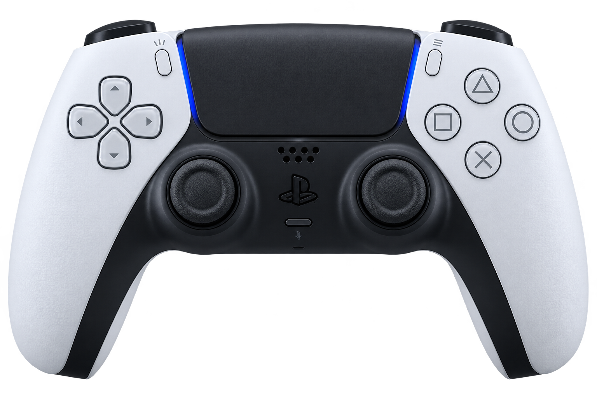
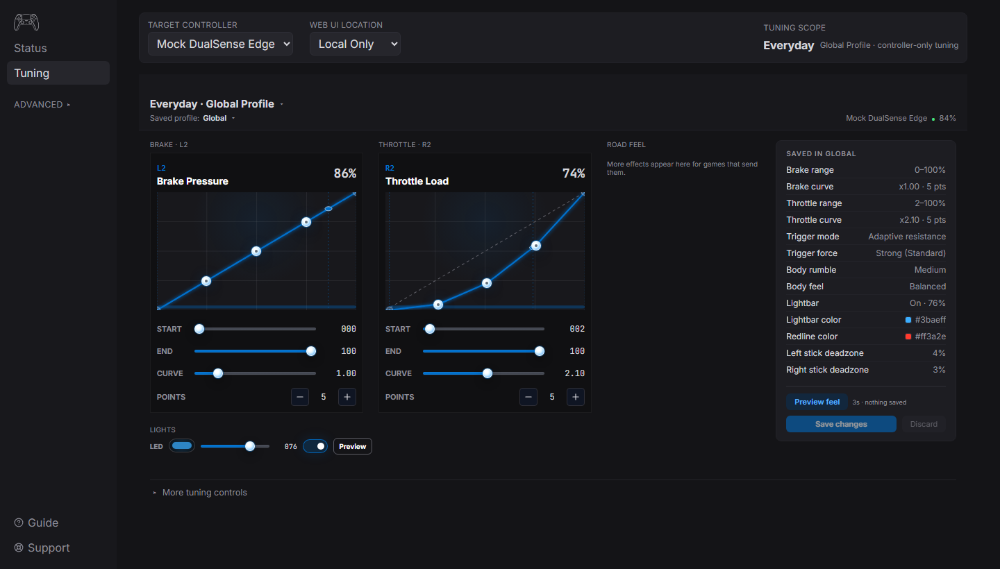
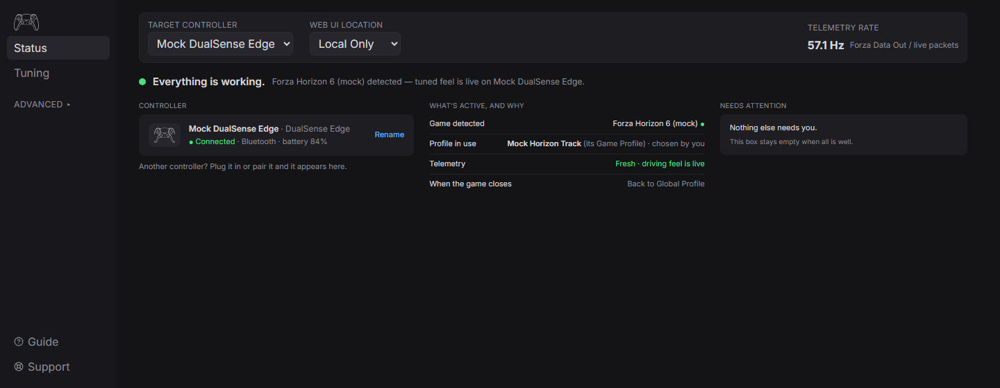

  

<h1 align="center">DualSense Command Center</h1>

  <b>Your controller. Your feel.</b> 
  Tune DualSense and DualSense Edge triggers, haptics, lights, and profiles. 
  A free local Windows app. Everyday setup needs no scripts or command line.

  
  
  
  

  <a href="#install-and-play">Install</a> ·
  <a href="docs/README.md">Documentation</a> ·
  <a href="CHANGELOG.md">Changelog</a> ·
  <a href="docs/contributing.md">Contributing</a>

  

<table>
  <tr>
    <td width="50%"><b>Dial in the feel</b> Adjust L2/R2 resistance, clicks, feedback curves, rumble, and lightbar behavior in one place.</td>
    <td width="50%"><b>Feel the drive</b> Route supported game telemetry into brake pressure, ABS, throttle, gear shifts, road texture, and more.</td>
  </tr>
  <tr>
    <td><b>A profile for each game</b> Keep everyday tuning in the Global Profile. Save, import, and export Game Profiles for automatic selection in supported games.</td>
    <td><b>See what's running</b> Check controller connection and battery, the detected game, the profile in use, and telemetry freshness at a glance.</td>
  </tr>
  <tr>
    <td><b>Mapping alongside Steam</b> Inspect supported Steam Input layouts and apply the Edge paddle-shift preset, with backups before edits.</td>
    <td><b>Local by default</b> The app and agent run on your PC. Network access stays on loopback unless you explicitly enable LAN access.</td>
  </tr>
</table>

  

  <i>Tuning and Status in the 0.5.1 UI, captured with built-in sample controller and telemetry data. Screenshots illustrate the interface; see the <a href="docs/hardware-matrix.md">hardware matrix</a> for validated hardware coverage.</i>

Linux remains [beta](docs/linux-beta.md).

## Install and play

Download the **Standard unsigned Windows MSI** from [release 0.5.1](https://github.com/shiftedx/dualsense-command/releases/tag/v0.5.1).
Windows may show trust prompts. Bridge installers are experimental.
[Build from source](docs/contributing.md) if needed.

1. Verify the MSI's SHA256 checksum and signing status using [Release Trust](docs/release-trust.md).
2. Quit any running DSCC from its tray menu, then run the MSI to install or update. Profiles/settings stay in your user folder. Leave **Start with Windows** unchecked until its [validation caveat](docs/release-trust.md) is resolved.
3. Open DSCC from Start or the tray; connect the controller by USB or Bluetooth.
4. Follow **Guide** and tune the **Global Profile**. Start a supported game for automatic Game Profile selection and telemetry effects.

Controller/transport coverage, installer lifecycle, Bridge validation and signing
have [remaining validation gaps](docs/production-readiness-plan.md). Check the
[hardware matrix](docs/hardware-matrix.md) for actual evidence.

| Workflow | Controls / setup |
| --- | --- |
| Controller tuning | L2/R2 resistance, clicks, feedback curves, rumble, lightbar, battery and connection status. |
| Profiles | Save, import, export, rename and switch tuning. |
| Forza Horizon 5 / Horizon 6 / Motorsport | Enable **Data Out / UDP Race Telemetry** at `127.0.0.1:5300`; brake, ABS, throttle, shifts, limiter, texture, slip and RPM effects. |
| Assetto Corsa Rally | Windows shared memory; enter a driving session and select the detected profile. No port setup. |
| Steam Input | Mirror supported mappings and apply the Edge paddle-shift preset; edits create backups. |
| Edge slots / optional Input Bridge | Follow the [hardware matrix](docs/hardware-matrix.md) / [installer guide](docs/release-trust.md). Live telemetry effects require DSCC running. |

## Output and privacy

The API defaults to `127.0.0.1:43473`; Forza UDP defaults to
`127.0.0.1:5300`. LAN exposure requires opt-in. Validated output frames guard
controller writes; no raw HID-write routes exist. Game trigger/rumble effects
require an active Game Profile and fresh telemetry; manual tests expire.

## Help and development

- Setup or connection trouble: [Troubleshooting](docs/troubleshooting.md).
- Bugs: export a sanitized bundle from **Support**, then file [an issue](https://github.com/shiftedx/dualsense-command/issues). Tuning questions: [Discussions](https://github.com/shiftedx/dualsense-command/discussions).
- Development: [Contributing](docs/contributing.md) covers safe runs and `npm.cmd run check`; [docs index](docs/README.md) maps source owners and workflows.

DSCC follows a [clean-room provenance policy](docs/provenance-policy.md).
Code uses [Apache-2.0](LICENSE); bundled assets/dependencies retain their
[third-party terms](THIRD_PARTY_NOTICES.md). Bridge distributions include the
HIDMaestro MIT notice in `hidmaestro\THIRD_PARTY_NOTICES.txt`.
